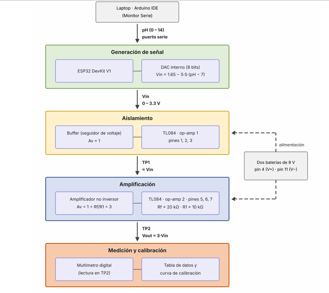
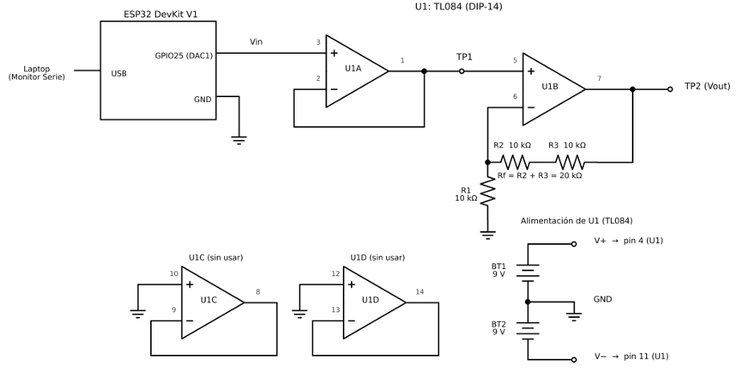
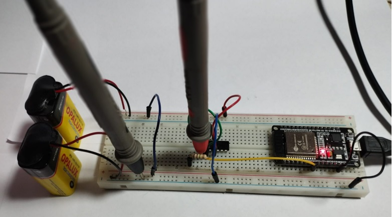
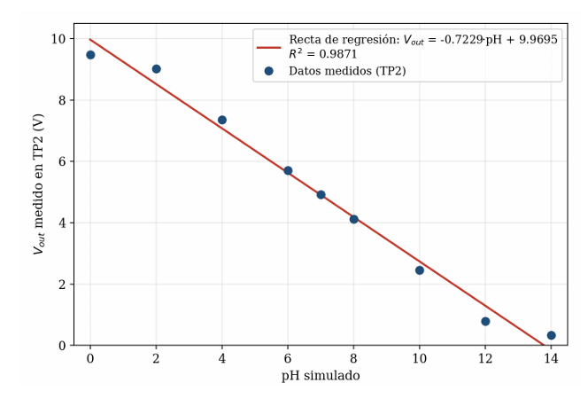

# Simulador de Electrodo de pH con ESP32 — Etapa de Ganancia y Calibración

**Informe de Laboratorio N.º 2 — Instrumentación Biomédica III**  
*Escuela Profesional de Ingeniería Biomédica — Universidad Nacional Mayor de San Marcos (UNMSM)*

---

## 1. Resumen

En esta experiencia se diseñó e implementó un sistema de acondicionamiento analógico para adaptar la señal proveniente de un electrodo de pH simulado mediante un microcontrolador ESP32. La etapa de hardware se estructuró con un amplificador operacional **TL084** dispuesto primeramente como seguidor de voltaje (buffer) para el acoplamiento de impedancias, seguido de una etapa no inversora orientada a escalar el rango dinámico de tensión. 

El amplificador se configuró con una ganancia teórica nominal $A_v = 3.0$, obteniéndose experimentalmente un valor de **$A_v = 2.995$** (error de solo 0.16%). A partir del barrido de 9 puntos de pH entre 0 y 14, la curva de calibración del sistema presentó una relación lineal descrita por $V_{\text{out}} = -0.7229 \cdot \text{pH} + 9.9695$, alcanzando un coeficiente de determinación **$R^2 = 0.9871$** y una sensibilidad de **$0.7229\text{ V/pH}$**.

---

## 2. Diagrama de Bloques y Arquitectura del Sistema

El flujo de procesamiento de la señal desde el puerto serie hasta la medición final se resume en el siguiente esquema:


*Figura 1. Diagrama de bloques del montaje desde la generación por software en el ESP32 hasta la medición en TP2.*

---

## 3. Esquemático Eléctrico y Montaje Físico

El circuito utiliza la salida del DAC (GPIO25) conectada a la primera etapa de aislamiento (Buffer, $A_v = 1$). La salida del buffer (Punto de prueba TP1) se conecta a la entrada no inversora de la segunda etapa amplificadora ($A_v = 1 + R_f/R_1 = 3$), implementada con $R_f = 20\text{ k}\Omega$ ($10\text{ k}\Omega + 10\text{ k}\Omega$ en serie) y $R_1 = 10\text{ k}\Omega$. El integrado TL084 es alimentado con fuente dual de $\pm 9\text{ V}$ mediante dos baterías.


*Figura 2. Circuito esquemático completo de las etapas buffer y amplificador no inversor.*


*Figura 3. Implementación física sobre protoboard del microcontrolador ESP32, CI TL084 y baterías de alimentación.*

---

## 4. Código Fuente de la Simulación (`simulador_ph.ino`)

El programa cargado en el ESP32 calcula el potencial teórico de Nernst a 25 °C:

$$E_{\text{Nernst}} = -0.05916 \times (\text{pH} - 7)$$

Se le aplica un factor de escala (5.0) y un offset de 1.65 V para acondicionarlo al rango dinámico del DAC (0 V a 3.3 V), entregando una salida analógica por el pin **GPIO25**.
## 5. Resultados y Curva de Calibración

### Tabla Consolidada de Mediciones ($V_{\text{in}}$ vs. $V_{\text{out}}$)

| pH Simulado | V Salida ESP32 / $V_{\text{in}}$ Teórico (V) | V Medido TP1 - Buffer (V) | Vout Teórico TP2 (V) | Vout Medido TP2 (V) |
| :---: | :---: | :---: | :---: | :---: |
| **0** | 3.3000 | 3.165 | 9.9000 | **9.480** |
| **2** | 3.1290 | 3.012 | 9.3870 | **9.020** |
| **4** | 2.5374 | 2.457 | 7.6122 | **7.360** |
| **6** | 1.9458 | 1.902 | 5.8374 | **5.705** |
| **7** | 1.6500 | 1.639 | 4.9500 | **4.915** |
| **8** | 1.3542 | 1.374 | 4.0626 | **4.120** |
| **10** | 0.7626 | 0.819 | 2.2878 | **2.456** |
| **12** | 0.1710 | 0.265 | 0.5130 | **0.792** |
| **14** | 0.0000 | 0.112 | 0.0000 | **0.336** |

### Curva de Calibración Experimental ($V_{\text{out}}$ vs. pH)


*Figura 4. Regresión lineal $V_{\text{out}}$ vs. pH simulado y datos experimentales medidos en TP2.*

* **Ecuación de calibración:** $V_{\text{out}} = -0.7229 \cdot \text{pH} + 9.9695$
* **Coeficiente de determinación ($R^2$):** $0.9871$
* **Ganancia experimental:** $A_{v,\text{exp}} = \frac{\Delta V_{\text{out}}}{\Delta V_{\text{in}}} = \frac{9.144\text{ V}}{3.053\text{ V}} = 2.995$ (Error respecto al teórico $A_v = 3.0$: **0.16%**)
* **Sensibilidad experimental:** $|a| = 0.7229\text{ V/pH}$

---

## 6. Componentes e Instrumental Utilizados

* Microcontrolador ESP32 DevKit V1
* Circuito Integrado TL084N (Op-amp cuádruple con entrada JFET)
* Resistencia $10\text{ k}\Omega$ ($\times 3$)
* Fuentes de energía: Dos baterías de $9\text{ V}$ (Alimentación dual $\pm 9\text{ V}$)
* Multímetro digital de precisión y Osciloscopio digital de banco
* Protoboard y cables jumper

---

## 7. Integrantes

* **Dávila Pucuhuayla, Jazmín Sarai** — *Código: 23190369*
* **Leon Vasquez, Jimmy Fabricio** — *Código: 23190378*
* **More Quispe, Gregory Martin** — *Código: 23190125*
* **Maldonado Villacorta, Paola Margot** — *Código: 23190124*
* **Sotomayor Villanueva, Genny Solangch** — *Código: 23190393*

**Docente:** Dra. María Elisia Armas Alvarado  
**Curso:** Instrumentación Biomédica III — Universidad Nacional Mayor de San Marcos (UNMSM)
```cpp
// Parámetros principales del código
const int DAC_PIN = 25;
const float SLOPE = 0.05916;     // V/pH (Nernst a 25 °C)
const float FACTOR_ESCALA = 5.0; // Factor de amplificación por software
const float OFFSET = 1.65;          // Desplazamiento continuo (V)
